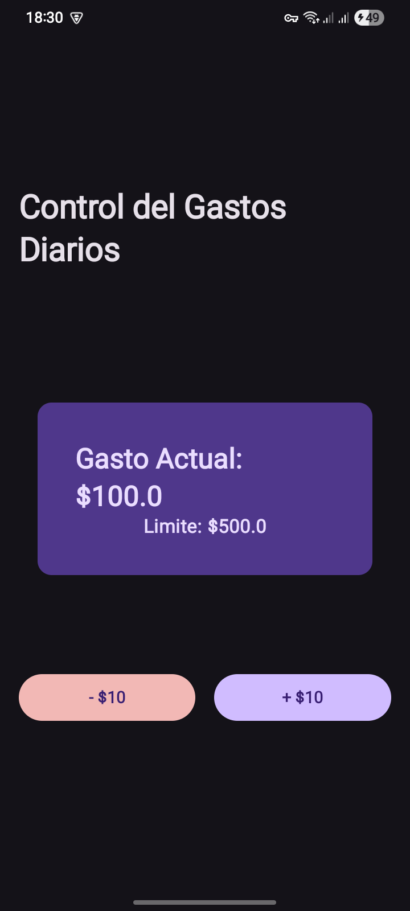

# ControlGastosDiarios

App Android de **Control de Gastos Diarios** construida con **Jetpack Compose** aplicando el patrón **MVI (Model-View-Intent)** y **StateFlow**.

> Taller: "Estado de la interfaz y flujo de datos"
> Tema: MVI con StateFlow en Compose

## Características implementadas

- Estado inmutable de la pantalla mediante `data class GastosState`.
- Intenciones del usuario tipadas con `sealed class GastosIntent`.
- `GastosViewModel` que expone un `StateFlow<GastosState>` de solo lectura y procesa cada intent.
- UI declarativa en Compose que observa el estado con `collectAsState()`.
- Incremento y decremento del gasto en pasos de `$10`.
- El gasto nunca baja de `0`.
- Límite por defecto de `$500` (configurable desde el ViewModel con `EstablecerLimite`).
- Mensaje de error en rojo cuando se supera el límite; el monto no se actualiza al superarlo.
- El error desaparece cuando el monto vuelve a estar dentro del límite.

## Arquitectura MVI

```
Usuario
  │  (pulsa +$10 / -$10)
  ▼
GastosIntent  ──►  GastosViewModel.handleIntent(intent)
                        │
                        │  _state.update { estado.copy(...) }
                        ▼
                 MutableStateFlow<GastosState>  (privado)
                        │  asStateFlow()
                        ▼
                 StateFlow<GastosState>  (público, solo lectura)
                        │  collectAsState()
                        ▼
                    UI Compose
```

### Flujo de datos

1. La **View** (Compose) no modifica el estado directamente.
2. La View emite un **Intent** (`viewModel.handleIntent(...)`).
3. El **ViewModel** calcula el nuevo estado y lo publica en un `StateFlow`.
4. La UI reacciona al nuevo estado y se recompone.

## Estructura del proyecto

```
ControlGastosDiarios/
├── app/
│   ├── src/main/java/com/tudominio/controlgastos/
│   │   ├── MainActivity.kt
│   │   └── ui/
│   │       ├── GastosState.kt
│   │       ├── GastosIntent.kt
│   │       ├── GastosViewModel.kt
│   │       └── theme/
│   │           ├── Color.kt
│   │           ├── Theme.kt
│   │           └── Type.kt
│   ├── src/main/res/
│   └── build.gradle.kts
├── gradle/
│   └── libs.versions.toml
├── build.gradle.kts
├── settings.gradle.kts
└── README.md
```

## Requisitos

- Android Studio (AGP 9.5.0, Gradle 9.6.0)
- Kotlin 2.4.21 (soporte Kotlin integrado de AGP 9)
- JDK 17+ (probado con el JBR de Android Studio)
- SDK: `compileSdk = 37`, `targetSdk = 37`, `minSdk = 24` (Android 7.0)
- Dispositivo o emulador con Android 7.0 o superior

## Compilar e instalar

```bash
# Compilar APK debug
./gradlew assembleDebug

# Instalar en un dispositivo conectado por USB (con depuración USB activa)
adb install -r app/build/outputs/apk/debug/app-debug.apk

# Abrir la app
adb shell am start -n com.tudominio.controlgastos2/com.tudominio.controlgastos.MainActivity
```

## Pruebas manuales

| Acción | Resultado esperado |
|---|---|
| Presionar "+ $10" | El monto actual aumenta en 10 |
| Presionar "- $10" | El monto actual disminuye en 10 (sin bajar de 0) |
| Seguir presionando "+" hasta superar 500 | Aparece mensaje de error en rojo |
| Presionar "-" después del error | El error desaparece si el monto vuelve al límite |

## Captura de pantalla

Agrega aquí una captura de la app en ejecución:

```

```

## Conexión con la 3ra Parte

Lo construido en esta app (State, Intent y ViewModel con StateFlow) será la base para la 3ra Parte, donde se:

- Extraerá la lógica de datos a un `GastosRepositorio`.
- Aprenderá a inyectar dependencias con **Koin**.
- Mostrará una lista de gastos guardados.

## Documentación del taller

La transcripción en Markdown del PDF del taller está en [`docs/Estado-interfaz-flujo-datos.md`](docs/Estado-interfaz-flujo-datos.md).
