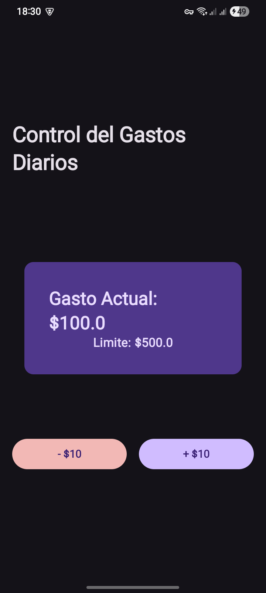

# ControlGastosDiariosKoin

App Android de **Control de Gastos Diarios** construida con **Jetpack Compose**, patrón **MVI (Model-View-Intent)**, **StateFlow** e **inyección de dependencias con Koin**.

> Taller: "Repositorio de usuarios e inyección de dependencias"
> Tema: Inyección de dependencias con Koin

## Características implementadas

- Modelo de datos `Gasto` y repositorio `GastosRepositorio` con implementación en memoria (`GastosRepositorioSimulado`).
- El `GastosViewModel` recibe el repositorio por constructor; ya no lo crea internamente.
- Inyección de dependencias con **Koin**: módulo `appModule`, `startKoin` en `ControlGastosApplication`.
- `koinViewModel()` en Compose para obtener el ViewModel con su repositorio inyectado.
- Carga automática del historial de gastos con indicador de carga (`isLoading`).
- Lista dinámica de gastos con `LazyColumn` y tarjeta por gasto (`TarjetaGasto`).
- Total acumulado calculado desde el repositorio.
- Alta de un gasto rápido de `$10` con el botón **Agregar**.
- Eliminación de gastos con el ícono de basura.
- Se conservan las funciones de la sesión anterior: `+ $10`, `- $10`, límite y mensaje de error.

## Arquitectura

```
UI Compose (MainActivity)
   │  emite GastosIntent
   ▼
GastosViewModel  ◄── inyectado por Koin ──┐
   │  depende de                          │
   ▼                                       │
GastosRepositorio ◄── GastosRepositorioSimulado
   │  (single en appModule)
   ▼
GastosState (StateFlow) ──► UI se recompone
```

### Flujo de datos

1. Koin crea una única instancia de `GastosRepositorioSimulado`.
2. Koin crea `GastosViewModel` y le inyecta ese repositorio con `get()`.
3. La UI obtiene el ViewModel con `koinViewModel()`.
4. Al iniciar, el ViewModel emite `CargarGastos` y publica la lista y el total en el `StateFlow`.
5. Cada intent (`AgregarGasto`, `EliminarGasto`, etc.) actualiza el repositorio y recarga el estado.

## Estructura del proyecto

```
ControlGastosDiariosKoin/
├── app/
│   ├── src/main/java/com/tudominio/controlgastos/
│   │   ├── MainActivity.kt
│   │   ├── ControlGastosApplication.kt
│   │   ├── data/
│   │   │   ├── Gasto.kt
│   │   │   └── GastosRepositorio.kt
│   │   ├── di/
│   │   │   └── AppModule.kt
│   │   └── ui/
│   │       ├── GastosState.kt
│   │       ├── GastosIntent.kt
│   │       ├── GastosViewModel.kt
│   │       └── theme/
│   │           ├── Color.kt
│   │           ├── Theme.kt
│   │           └── Type.kt
│   ├── src/main/res/
│   └── build.gradle.kts
├── gradle/
│   └── libs.versions.toml
├── build.gradle.kts
├── settings.gradle.kts
└── README.md
```

## Dependencias agregadas

En `gradle/libs.versions.toml`:

```toml
koin = "4.2.2"

androidx-compose-material-icons-extended = { group = "androidx.compose.material", name = "material-icons-extended" }
koin-android = { group = "io.insert-koin", name = "koin-android", version.ref = "koin" }
koin-compose = { group = "io.insert-koin", name = "koin-androidx-compose", version.ref = "koin" }
koin-core = { group = "io.insert-koin", name = "koin-core", version.ref = "koin" }
```

En `app/build.gradle.kts`:

```kotlin
implementation(libs.androidx.compose.material.icons.extended)
implementation(libs.koin.android)
implementation(libs.koin.compose)
implementation(libs.koin.core)
```

> Nota: se usa Koin 4.2.2 para mantener compatibilidad con el stack actual del proyecto
> (AGP 9.5.0 / Kotlin 2.4.21 / Compose BOM 2026.09.00). La API utilizada es la misma del
> instructivo (`org.koin.androidx.compose.koinViewModel`, `org.koin.androidx.viewmodel.dsl.viewModel`).

## Requisitos

- Android Studio (AGP 9.5.0, Gradle 9.6.0)
- Kotlin 2.4.21 (soporte Kotlin integrado de AGP 9)
- JDK 17+ (probado con el JBR de Android Studio)
- SDK: `compileSdk = 37`, `targetSdk = 37`, `minSdk = 24` (Android 7.0)
- Dispositivo o emulador con Android 7.0 o superior

## Compilar e instalar

```bash
# Compilar APK debug
./gradlew assembleDebug

# Instalar en un dispositivo conectado por USB (con depuración USB activa)
adb install -r app/build/outputs/apk/debug/app-debug.apk

# Abrir la app
adb shell am start -n com.tudominio.controlgastos/.MainActivity
```

## Pruebas manuales

| Acción | Resultado esperado |
|---|---|
| Abrir la app | Muestra un loader breve y luego la lista de ejemplo (Café, Almuerzo, Supermercado, Taxi) |
| Presionar "+ $10" | Aumenta el "Gasto actual" |
| Presionar "- $10" | Disminuye el "Gasto actual" sin bajar de 0 |
| Presionar "Agregar" | Guarda un gasto de `$10` ("Gasto rápido") y aparece al inicio de la lista |
| Presionar el ícono de basura | Elimina ese gasto de la lista |
| Observar "Total acumulado" | Refleja la suma correcta de todos los gastos del repositorio |

## Captura de pantalla

Reemplaza `docs/captura.png` con una captura de esta app en ejecución:

```

```

## Documentación del taller

La transcripción en Markdown del PDF del taller está en
[`docs/Repositorio-usuarios-inyeccion-dependencias.md`](docs/Repositorio-usuarios-inyeccion-dependencias.md).
