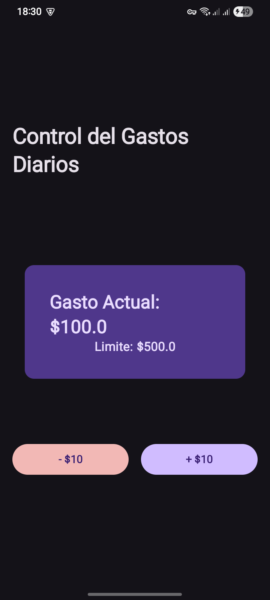

# ControlGastosDiariosNavegacion (4_app)

App Android de **Control de Gastos Diarios** con **Jetpack Compose**, **MVI + StateFlow**, **Koin**, **Navigation Compose** y **DataStore** para persistir la sesión.

> Taller: "Asignación de acceso y verificación de pantallas"
> Tema: Navegación, autenticación y protección de rutas

Esta es la evolución de la 3_app: el código es acumulativo y agrega login, sesión persistente y rutas protegidas.

## Funcionalidades implementadas

- Pantalla de **Login** pública con validación de credenciales.
- Credenciales de prueba:
  - Email: `demo@controlgastos.com`
  - Contraseña: `123456`
- Sesión persistente con **DataStore Preferences**: si ya inició sesión, la app entra directo a gastos.
- **Cierre de sesión** que borra los datos de sesión y vuelve al login.
- **Navigation Compose** con rutas tipadas (`Pantalla.Login`, `Pantalla.Gastos`, `Pantalla.Configuracion`).
- Rutas de gastos y configuración **protegidas**: sin autenticación redirigen al login.
- Encabezado con nombre del usuario, botón de configuración y botón de logout.
- Se conservan todas las funciones de la 3_app: MVI, repositorio en memoria, Koin, lista de gastos, total acumulado, alta y eliminación.

## Arquitectura

```
MainActivity
   │
   ▼
AppNavegacion (NavHost)
   ├── login  ──► PantallaLogin ──► GastosIntent.Login
   ├── gastos ──► PantallaGastos ──► GastosIntent.* (protegida)
   └── configuracion (protegida)

GastosViewModel
   ├── GastosRepositorio (Koin single)
   ├── SesionManager (Koin single + DataStore)
   ├── StateFlow<GastosState>
   ├── StateFlow<Boolean> estaAutenticado
   └── StateFlow<String> usuarioNombre
```

## Estructura del proyecto

```
ControlGastosDiariosNavegacion/
├── app/
│   ├── src/main/java/com/tudominio/controlgastos/
│   │   ├── MainActivity.kt
│   │   ├── ControlGastosApplication.kt
│   │   ├── data/
│   │   │   ├── Gasto.kt
│   │   │   ├── GastosRepositorio.kt
│   │   │   └── SesionManager.kt
│   │   ├── di/
│   │   │   └── AppModule.kt
│   │   ├── navigation/
│   │   │   └── Pantallas.kt
│   │   └── ui/
│   │       ├── GastosState.kt
│   │       ├── GastosIntent.kt
│   │       ├── GastosViewModel.kt
│   │       ├── PantallaLogin.kt
│   │       ├── PantallaGastos.kt
│   │       └── theme/
│   ├── src/main/res/
│   └── build.gradle.kts
├── gradle/
│   └── libs.versions.toml
├── build.gradle.kts
├── settings.gradle.kts
└── README.md
```

## Dependencias agregadas

```toml
navigationCompose = "2.10.2"
datastore = "1.3.0"

androidx-navigation-compose = { group = "androidx.navigation", name = "navigation-compose", version.ref = "navigationCompose" }
androidx-datastore-preferences = { group = "androidx.datastore", name = "datastore-preferences", version.ref = "datastore" }
```

> Se mantiene el stack actual del proyecto (AGP 9.5.0, Kotlin 2.4.21, Compose BOM 2026.09.00, Koin 4.2.2)
> y se usan versiones actuales de Navigation y DataStore compatibles con ese stack.

## Requisitos

- Android Studio (AGP 9.5.0, Gradle 9.6.0)
- Kotlin 2.4.21
- JDK 17+
- SDK: `compileSdk = 37`, `targetSdk = 37`, `minSdk = 24` (Android 7.0)
- Dispositivo o emulador con Android 7.0 o superior

## Compilar e instalar

```bash
./gradlew assembleDebug

adb install -r app/build/outputs/apk/debug/app-debug.apk

adb shell am start -n com.tudominio.controlgastos4/com.tudominio.controlgastos.MainActivity
```

## Pruebas manuales

| Acción | Resultado esperado |
|---|---|
| Abrir la app por primera vez | Muestra la pantalla de Login |
| Intentar ver gastos sin login | La ruta protegida redirige al Login |
| Login con credenciales incorrectas | Muestra "Email o contraseña incorrectos" |
| Login con `demo@controlgastos.com` / `123456` | Navega a la pantalla de gastos |
| Presionar "Cerrar sesión" | Vuelve al Login y borra la sesión |
| Cerrar y reabrir la app con sesión activa | Entra directo a la pantalla de gastos |
| Presionar el botón Atrás en gastos | Sale de la app, no vuelve al Login |
| Presionar el ícono de configuración | Abre la pantalla "En Construcción" |

## Captura de pantalla

Reemplaza `docs/captura.png` con una captura de esta app en ejecución:

```

```

## Documentación del taller

La transcripción en Markdown del PDF está en
[`docs/Asignacion-acceso-verificacion-pantallas.md`](docs/Asignacion-acceso-verificacion-pantallas.md).
